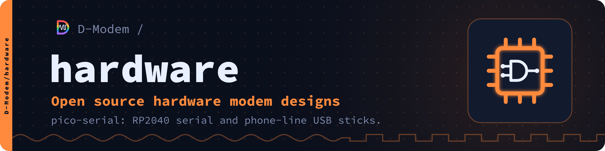

# pico-serial

Open RP2040 boards for the D-Modem suite: serial adapters and phone-line
USB sticks.

pico-serial connects a phone or computer running [D-Modem](https://github.com/D-Modem/D-Modem)
or [the D-Modem app](https://github.com/D-Modem/app) to vintage serial
ports and to real telephone lines. Every board is a bare RP2040 with its
own flash, crystal and regulator: no Pico module.

| Board | What it is | Spec |
| --- | --- | --- |
| pico-serial | USB-C to DB25 RS-232. One female DB25 works as a modem (DCE) or a computer port (DTE), detected automatically | [SPEC.md](SPEC.md) |
| pico-serial W | The same adapter with Bluetooth: BLE for iPhone and iPad, classic Bluetooth serial for Android | [SPEC-W.md](SPEC-W.md) |
| pico-serial Line | A USB modem stick for a real telephone line: a Si3056 DAA, the modem itself being D-Modem on the host | [SPEC-L.md](SPEC-L.md) |
| pico-serial WB | A wideband stick for bare copper pairs, sampling at 96 kHz for D-Modem's V.wb mode | [SPEC-WB.md](SPEC-WB.md) |

Status: the specs are drafts. CI builds the firmware and runs its tests
on the host and in an RP2040 emulator; the boards are generated for
KiCad 9. Nothing has run on a real board yet.

## Quick start

```sh
cmake -S firmware -B firmware/build -G Ninja   # -DPS_BOARD=hood, w, line, wb or pico
ninja -C firmware/build                        # -> firmware/build/pico-serial-hood.uf2
```

The board files are generated from `hardware/netlist/build_netlist.py`.

## Documentation

The documentation is also a website, [d-modem.github.io/hardware](https://d-modem.github.io/hardware/), with reference pages made from the code.

- [docs/](docs/README.md): an index of every spec and guide
- [Firmware](firmware/README.md): building, flashing, Bluetooth, tests
- [Control protocol](firmware/PROTOCOL.md): the USB vendor interface for host apps
- [Hardware](hardware/README.md): netlist, schematic, PCB, enclosures

## The D-Modem suite

| Repository | What it is |
| --- | --- |
| [D-Modem](https://github.com/D-Modem/D-Modem) | The open V.92 softmodem: dmodemd, libdmodem and the Asterisk, FreeSWITCH and ARI modules |
| [app](https://github.com/D-Modem/app) | The D-Modem app for Android and iOS: a dial-up modem on a SIP call |
| [hardware](https://github.com/D-Modem/hardware) | pico-serial: RP2040 serial adapters and phone-line USB sticks |
| [menu](https://github.com/D-Modem/menu) | modemmenu: the login and menu dial-up callers reach |
| [bbs](https://github.com/D-Modem/bbs) | A bulletin board for telnet, SSH, TN3270 and modem callers |
| [go3270](https://github.com/D-Modem/go3270) | A Go library for 3270 terminal servers, used by bbs |
| [brand](https://github.com/D-Modem/brand) | Logos, colours, type and the naming guide |

ISDN S0 stick (an ISDN basic rate S/T port for D-Modem, TE or NT): see [SPEC-S0.md](SPEC-S0.md).

FPGA line board (study: ADSL, ISDN U or S0 by gateware and host software): see [SPEC-FX.md](SPEC-FX.md).

## Licence

Firmware: AGPL-3.0-only, or a commercial licence from the D-Modem Authors. Hardware: CERN-OHL-S-2.0, or a commercial licence from the D-Modem Authors. See [LICENSING.md](LICENSING.md). Contributions come with a contributor agreement ([CONTRIBUTING.md](CONTRIBUTING.md)).
