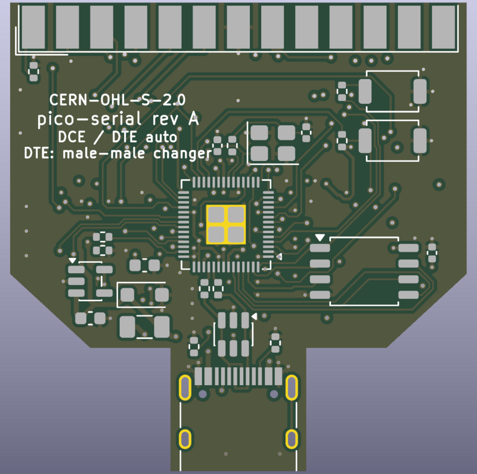
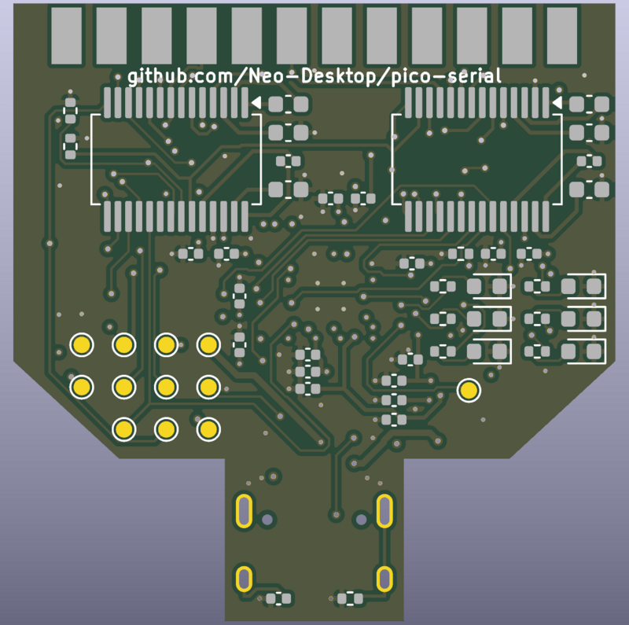

<!-- SPDX-License-Identifier: CERN-OHL-S-2.0 -->
<!-- Copyright (C) 2026 Neo-Desktop -->
# pico-serial hardware

`netlist/build_netlist.py` defines every part and every connection on the
board. The netlist, the readable net list, the JLC parts list, the
schematic and the PCB are all generated from it, so change the script,
not the outputs.

Everything targets **KiCad 9**: KiCad 9 file formats and the KiCad 9.0
symbol and footprint libraries. KiCad 10 opens it too.

| File | What it is |
|---|---|
| `netlist/build_netlist.py` | The circuit: parts, nets, the checks |
| `netlist/pico-serial.net` | KiCad netlist (generated) |
| `netlist/NETLIST.md` | Every net and every part, readable (generated) |
| `netlist/bom-jlc.csv` | JLC assembly parts list with LCSC numbers (generated) |
| `kicad/build_schematic.py` | Draws the schematic from the netlist script |
| `kicad/pico-serial.kicad_sch` | KiCad schematic, one A2 sheet (generated) |
| `kicad/pico-serial.kicad_sym` | SP3238E and MAX3243E symbols, which KiCad doesn't ship (generated) |
| `kicad/preview.svg` | Rough drawing of the sheet for a quick look (generated) |
| `kicad/build_pcb.py` | Lays out and routes the PCB: outline, rules, placement, planes |
| `kicad/pico-serial.kicad_pcb` | KiCad PCB, 4 layers (generated) |
| `kicad/pico-serial.kicad_dru` | Two board-specific DRC rules (the DB25 cups and USB-C shell at the edges) |
| `kicad/fab/` | Gerbers + drill (zip) and the JLC placement file (generated) |
| `kicad/render-top.png`, `render-bottom.png` | KiCad 3D renders, without part models (generated) |

## Regenerate

```sh
python3 hardware/netlist/build_netlist.py       # checks + netlist, NETLIST.md, BOM
python3 hardware/kicad/build_schematic.py   # checks + schematic and preview
python3 hardware/kicad/build_pcb.py --kicad-fp kicad-footprints --route --fab   # PCB (see below)
```

Neither needs KiCad or a network connection. The schematic script uses
symbols cached in `kicad/lib/symbol-cache.sexp`.

To check every pin against KiCad's own libraries, and to refresh the
symbol cache, point the scripts at the KiCad 9.0 library checkouts:

```sh
git clone --depth 1 --branch 9.0.6 https://gitlab.com/kicad/libraries/kicad-symbols.git
git clone --depth 1 --branch 9.0.6 https://gitlab.com/kicad/libraries/kicad-footprints.git
python3 hardware/netlist/build_netlist.py --kicad-sym kicad-symbols --kicad-fp kicad-footprints
python3 hardware/kicad/build_schematic.py --kicad-sym9 kicad-symbols
```

It stops with an error, and writes nothing, if:
- a pin is neither connected nor listed as deliberately open;
- a net has only one pin;
- a net has two outputs;
- an RS-232 line doesn't have exactly one driver and one receiver;
- a power input isn't on a supply net;
- with the KiCad checkouts: a pin number or name differs from KiCad's
  symbol, or a footprint lacks a pad for a pin.

## What's in it

The circuit follows `../SPEC.md` (draft 0.3): §4.2–4.8 for the parts and
§4.6 for the GPIO map.

- **Power and USB:**
  - USB-C (HRO TYPE-C-31-M-12) with its own 5.1 kΩ on each CC pin;
  - 0.5 A PTC fuse, 5 V TVS diode, USBLC6 ESD protection;
  - AP2112K 3.3 V regulator, VBUS ÷2 sense into GP29.
- **RP2040:**
  - Raspberry Pi's minimal design: per-pin decoupling, 12 MHz crystal
    with 15 pF caps and 1 kΩ on XOUT, 27 Ω USB series resistors;
  - W25Q128JV flash;
  - BOOTSEL and RESET buttons, 10 kΩ RUN pull-up.
- **RS-232:**
  - SP3238E (chip A, DCE) and MAX3243E (chip B, DTE) on the same 8 DB25
    pins, so every line has one driver and one receiver;
  - each chip has 220 nF + 1 µF charge-pump caps and 1 µF + 100 nF on VCC;
  - both chips are held off by 100 kΩ pull-downs until firmware chooses
    a role.
- **DB25:** solder-cup female (MH Connectors MHDB25SS). Pin 7 to GND, pin
  1 to GND through a 0 Ω link. All other unused pins stay open.
- **Optional:** six status LEDs on GP22–27, not fitted (DNP).
- **Test pads:** VBUS, 3V3, 1V1, GND, SWCLK, SWDIO, RUN, GP28, and the TX/RX
  lines of both chips.

The two RS-232 chips have no KiCad symbol. Their pin tables are copied
from the datasheets (MaxLinear SP3238E rev 1.0.1; TI MAX3243E SLLS657E,
Table 6-2) and marked as such in the script. Every other part's pins
match KiCad's library symbols.

## The schematic

`kicad/pico-serial.kicad_sch` is one A2 sheet in blocks:
- USB-C, protection and supply;
- RP2040 and its decoupling;
- crystal, flash and buttons;
- chip A (DCE) and chip B (DTE), each with its charge-pump capacitors;
- the DB25;
- the optional LEDs;
- test pads and the power flags ERC needs.

Every pin ends in a short wire with a net label or power symbol, so parts
connect by name, not by long wires. Each part carries its LCSC number, a
note on its purpose, and its footprint.

The schematic script refuses to write if:
- the connections read back from the drawing differ from the netlist in
  any way (a missing pin, an extra join, a pin touching the middle of a
  wire);
- any two texts, labels or symbols overlap.

It's generated, so hand edits are overwritten on the next run. Either
change `build_netlist.py` and regenerate, or stop generating and edit in
KiCad from then on.

## The PCB




`kicad/pico-serial.kicad_pcb`, made by `kicad/build_pcb.py` with KiCad
9's Python module (pcbnew). **Status:** fully routed; KiCad 9.0.9's DRC
finds no errors, no warnings and nothing unconnected, and the PCB matches
the schematic exactly (DRC's schematic parity check). CI checks all of
this on every change (`.github/workflows/hardware.yml`). Not yet
reviewed by a person, and nothing has been built.

- **Board:** about 37 × 38 mm, 4 layers, 1.6 mm; JLCPCB's standard
  4-layer process with margin (0.127 mm clearance, 0.15 mm tracks,
  0.25 mm via drills). The outline is SPEC §7.2's inferred one: full width at the DB25,
  narrowing behind, and a tongue for the USB-C into the hood's cable exit.
  It's set at the top of the script; **confirm it on a sample hood**.
- **DB25:** the board's front edge slides between the solder cups: pins
  1-13 on top, 14-25 underneath.
- **Top:** RP2040, flash, crystal, buttons; USB-C, ESD, fuse, TVS and the
  regulator at the back.
- **Bottom:** both transceivers with their charge pumps, right behind the
  cups (seen from the top, chip A/U5 is on the left and chip B/U6 on the
  right, the order with the fewest crossing connections); the RP2040's
  decoupling, about 2 mm from its pins; test pads; the
  optional LEDs.
- **Layers:**
  - F.Cu: signals, then a GND pour;
  - In1.Cu: solid GND plane under everything;
  - In2.Cu: signals, then a +3V3 pour in the space left;
  - B.Cu: signals, then a GND pour.
- **Vias:** every GND and +3V3 pad gets its own short stub and via before
  routing. The RP2040's +3V3 pins have theirs under the package, between
  the pins and the exposed pad, so the ring around it stays free for the
  signals; the exposed pad has four.
- **Kept clear:**
  - the USB D+/D- path from the RP2040 to the series resistors and the
    ESD chip has no vias across it;
  - nothing passes under the crystal on the top layer (keep-outs between
    its pads); the In1 GND plane shields it from the rest;
  - a 0.35 mm band inside the board edge has no tracks or vias
    (Freerouting doesn't apply KiCad's edge clearance).
- **Silkscreen:** on top, name and revision, "DCE / DTE auto", the
  gender-changer note and `CERN-OHL-S-2.0`; underneath, between the cups
  and the chips, `github.com/Neo-Desktop/pico-serial` (the licence's
  Source Location). Reference designators are on the fab layers; there's
  no room for them on the silkscreen.
- **Linked to the schematic:** every footprint carries its symbol's ID,
  and every pad its net under the name KiCad gives it.

### Test pads (bottom)

1 mm pads on a 2.6 mm grid behind the flash, for pogo pins; GP28 sits
apart, by the RP2040's left side. Coordinates in mm, from the middle of
the DB25 edge, toward the USB-C:

| y \ x | 6.5 | 9.1 | 11.7 | 14.3 |
|---|---|---|---|---|
| 21.0 | TP1 VBUS | TP2 3V3 | TP3 1V1 | TP4 GND |
| 23.6 | TP5 SWCLK | TP6 SWDIO | TP7 RUN | TP9 A_TX |
| 26.2 | TP10 A_RX | TP11 B_TX | TP12 B_RX | |

TP8 (GP28) is at x = -9.5, y = 23.8.

### Rebuilding it

```sh
python3 hardware/kicad/build_pcb.py --kicad-fp kicad-footprints \
    --route --freerouting freerouting-1.9.0.jar --fab
```

- **Needs:** KiCad 9 (its Python module and `kicad-cli`), the KiCad 9.0
  footprint libraries, Java, `xvfb-run`, and
  [Freerouting](https://github.com/freerouting/freerouting) 1.9.0.
  Freerouting 2.1 ignores its pass limit on the command line, so 1.9 it
  is; it wants a display, hence `xvfb-run`.
- **Routing:** Freerouting routes everything but GND, which the plane and
  the vias already connect. It runs in rounds, each starting from the
  last (`--rounds`). Then a small grid router in the script (A* on a
  0.1 mm grid over the three signal layers, checked against KiCad's own
  copper shapes) joins anything still apart.
- **Repeatable:** Freerouting gives the same result for the same board and
  pass count. If a pass count leaves something unrouted, the script tries
  the next in `--passes` (40, 30, 50, 35, 45) and keeps the first that
  routes everything. It says which it kept, and warns if none did.
- **Without `--route`** it writes the placed, unrouted board (with its
  vias and planes); `--ses` imports a saved Freerouting session instead.
- **`--fab`** writes `fab/pico-serial-gerbers.zip` and
  `fab/pico-serial-cpl-jlc.csv`. Upload the zip, `netlist/bom-jlc.csv` and
  the CPL file to JLCPCB. The DB25 is hand-soldered, so it's in neither
  list.
- **Before ordering assembly:** parts go on both sides (two-sided
  assembly costs extra). Check every part's rotation in JLC's preview,
  bottom-side ones especially: the CPL comes straight from KiCad, and
  JLC's footprints don't always agree on 0°.

## Using it in KiCad

1. Open `kicad/pico-serial.kicad_pro` in KiCad 9 or 10. The project
   table points at `pico-serial.kicad_sym`, which has the two RS-232
   symbols. Every symbol is also embedded in the schematic.
2. Run ERC: clean (KiCad 9.0.9, with the 9.0 libraries).
3. Open the PCB and run DRC, with the schematic parity check: clean.
4. The PCB is linked to the schematic, so **Update PCB from Schematic**
   works as usual. DRC's parity check, the same comparison, finds no
   difference. (The update itself hasn't been run: there was no KiCad GUI
   where this was made.)

## Before ordering

- **Have a person review the layout.** It's autorouted, so check what a
  router doesn't weigh: the crystal and its loop, the decoupling, the USB
  pair, the RS-232 lines near the cups. It routes cleanly, not
  necessarily well.
- Lock the board outline from the sample connector and hood (SPEC §7, §9),
  and check the board slides between the DB25's cups.
- Bench test the SP3238E's leakage while shut down (SPEC §8). If it fails,
  the DCE chip changes to the TI TRS3238E (TSSOP-28) and its footprint
  changes too.
