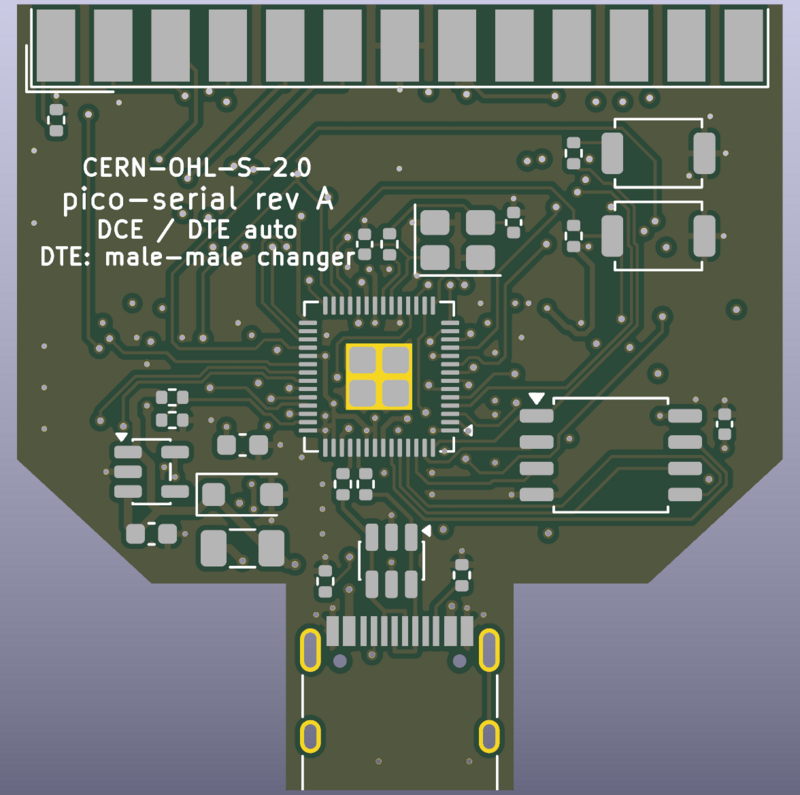
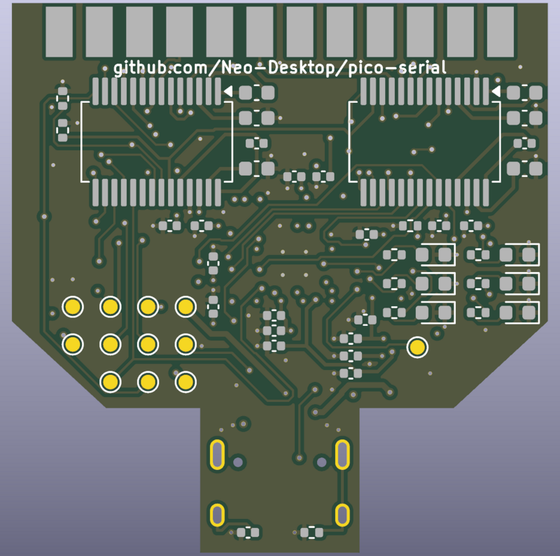
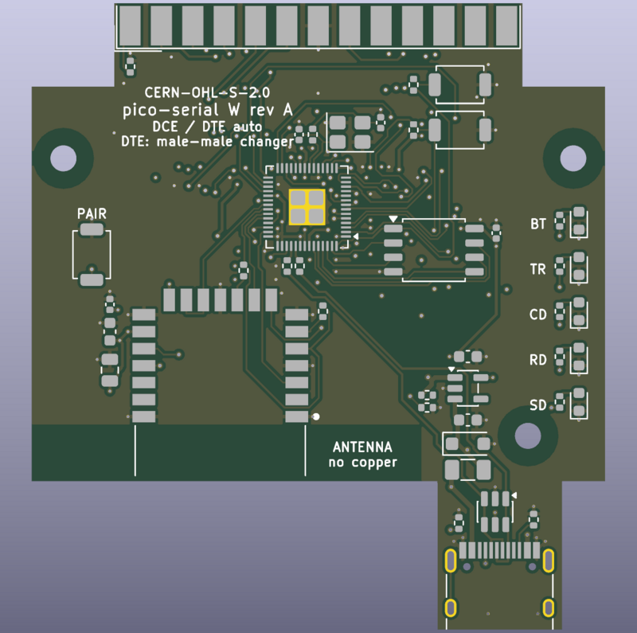
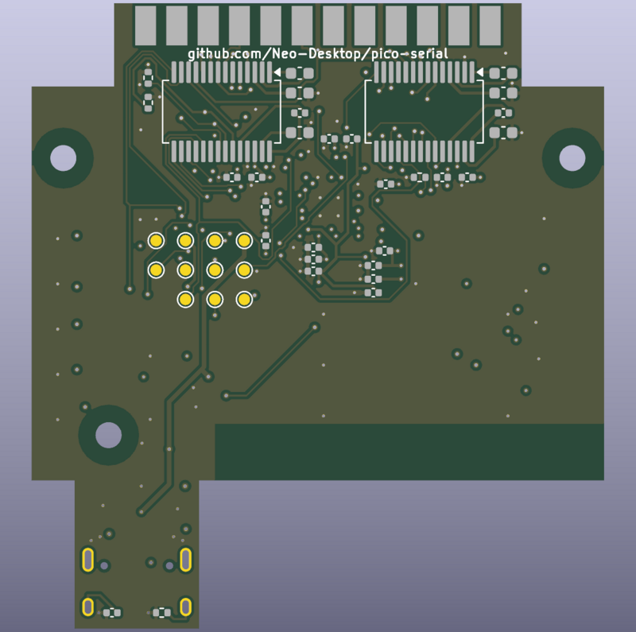
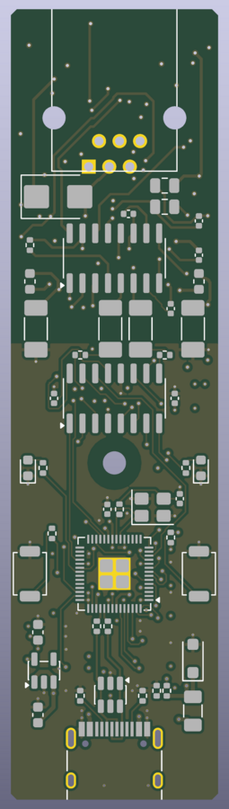
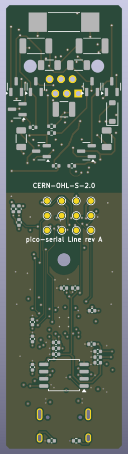
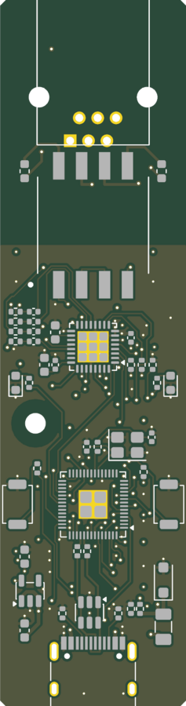
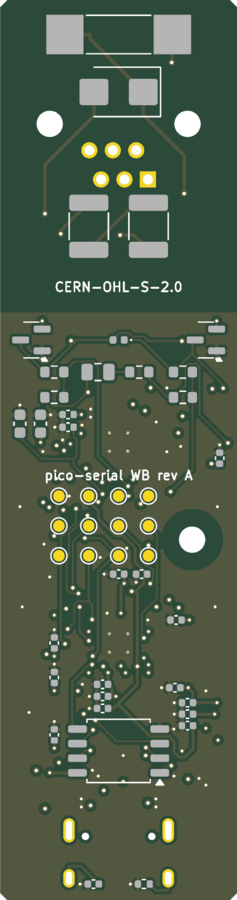

<!-- SPDX-License-Identifier: CERN-OHL-S-2.0 -->
<!-- Copyright (C) 2026 D-Modem Authors -->
# pico-serial hardware

`netlist/build_netlist.py` defines all parts and all connections on the
board. The scripts make the netlist, the readable net list, the JLC parts
list, the schematic and the PCB from it. Thus, change the script, not the
outputs.

The script makes these boards:
- The **hood board** (the default). It fits in a standard DB25 hood.
- **pico-serial W** (`--variant w`, [SPEC-W.md](../SPEC-W.md)). It adds an
  RM2 Bluetooth module, and it is in a 3D-printed hood (`enclosure/`). Its
  files have a `-w` suffix. See [pico-serial W](#pico-serial-w-bluetooth).
- **pico-serial Line** (`--variant line`, [SPEC-L.md](../SPEC-L.md)). It is
  a different device on the same RP2040 core: a USB-C stick that connects to
  a telephone line, for D-Modem. Its files have a `-line` suffix. See
  [pico-serial Line](#pico-serial-line-phone-line-stick).

All files are for **KiCad 9**: KiCad 9 file formats and the KiCad 9.0
symbol and footprint libraries. KiCad 10 also opens them.

| File | What it is |
|---|---|
| `netlist/build_netlist.py` | The circuit: parts, nets, the checks |
| `netlist/pico-serial.net` | KiCad netlist (generated) |
| `netlist/NETLIST.md` | All nets and all parts, in a readable form (generated) |
| `netlist/bom-jlc.csv` | JLC assembly parts list with LCSC numbers (generated) |
| `kicad/build_schematic.py` | Draws the schematic from the netlist script |
| `kicad/pico-serial.kicad_sch` | KiCad schematic, one A2 sheet (generated) |
| `kicad/pico-serial.kicad_sym` | SP3238E and MAX3243E symbols. KiCad does not supply these symbols (generated) |
| `kicad/preview.svg` | Approximate drawing of the sheet for a quick examination (generated) |
| `kicad/build_pcb.py` | Makes the layout of the PCB and routes it: outline, rules, placement, planes |
| `kicad/pico-serial.kicad_pcb` | KiCad PCB, 4 layers (generated) |
| `kicad/pico-serial.kicad_dru` | Two DRC rules for this board (the DB25 cups and the USB-C shell at the edges) |
| `kicad/fab/` | Gerbers + drill (zip) and the JLC placement file (generated) |
| `kicad/render-top.png`, `render-bottom.png` | KiCad 3D renders, without part models (generated) |
| `netlist/pico-serial-w.net`, `NETLIST-w.md`, `bom-jlc-w.csv` | The same for pico-serial W (generated) |
| `kicad/pico-serial-w.*`, `preview-w.svg`, `render-w-*.png` | The schematic, PCB, rules and renders of pico-serial W |
| `kicad/lib/make_footprints.py` | Writes `lib/pico-serial.pretty/`: the RM2 (from the drawing in its datasheet), the M2 screw hole, the RJ11 and the telecom fuse |
| `netlist/*-line.*`, `kicad/pico-serial-line.*`, `kicad/render-line-*.png` | The netlist, BOM, schematic, PCB, rules and renders of pico-serial Line |
| `netlist/*-wb.*`, `kicad/pico-serial-wb.*`, `kicad/render-wb-*.png` | The netlist, BOM, schematic, PCB, rules and renders of pico-serial WB |
| `enclosure/stick.py`, `enclosure/out-line/` | The printed shell of the Line stick, its board outline and placement |
| `kicad/fp-lib-table` | Points KiCad to `lib/pico-serial.pretty` |

## Regenerate

```sh
python3 hardware/netlist/build_netlist.py       # checks + netlist, NETLIST.md, BOM
python3 hardware/kicad/build_schematic.py   # checks + schematic and preview
python3 hardware/kicad/build_pcb.py --kicad-fp kicad-footprints --route --fab   # PCB (see below)
```

For pico-serial W, add `--variant w` to each command.

The netlist and schematic scripts do not need KiCad or a network
connection. The schematic script uses the symbols in the cache
`kicad/lib/symbol-cache.sexp`.

To compare all pins with the libraries of KiCad, and to update the symbol
cache, give the scripts the checkouts of the KiCad 9.0 libraries:

```sh
git clone --depth 1 --branch 9.0.6 https://gitlab.com/kicad/libraries/kicad-symbols.git
git clone --depth 1 --branch 9.0.6 https://gitlab.com/kicad/libraries/kicad-footprints.git
python3 hardware/netlist/build_netlist.py --kicad-sym kicad-symbols --kicad-fp kicad-footprints
python3 hardware/kicad/build_schematic.py --kicad-sym9 kicad-symbols
```

The script stops with an error, and writes nothing, if one of these
conditions occurs:
- A pin is not connected and it is not in the list of pins that are open
  intentionally.
- A net has only one pin.
- A net has two outputs.
- An RS-232 line does not have exactly one driver and one receiver.
- A power input is not on a supply net.
- With the KiCad checkouts: a pin number or name is different from the
  symbol of KiCad, or a footprint does not have a pad for a pin.

## What's in it

The circuit follows `../SPEC.md` (draft 0.3): §4.2–4.8 for the parts and
§4.6 for the GPIO map.

- **Power and USB:**
  - USB-C (HRO TYPE-C-31-M-12) with a separate 5.1 kΩ on each CC pin.
  - 0.5 A PTC fuse, 5 V TVS diode, USBLC6 ESD protection.
  - AP2112K 3.3 V regulator, VBUS ÷2 sense into GP29.
- **RP2040:**
  - The minimal design of Raspberry Pi: decoupling on each pin, 12 MHz
    crystal with 15 pF capacitors and 1 kΩ on XOUT, 27 Ω USB series
    resistors.
  - W25Q128JV flash.
  - BOOTSEL and RESET buttons, 10 kΩ RUN pull-up.
- **RS-232:**
  - SP3238E (chip A, DCE) and MAX3243E (chip B, DTE) on the same 8 DB25
    pins. Thus each line has one driver and one receiver.
  - Each chip has 220 nF + 1 µF charge-pump capacitors and 1 µF + 100 nF
    on VCC.
  - 100 kΩ pull-downs keep the two chips off until the firmware selects a
    role.
- **DB25:** solder-cup female (MH Connectors MHDB25SS). Pin 7 to GND, pin
  1 to GND through a 0 Ω link. All other unused pins stay open.
- **Optional:** six status LEDs on GP22–27, not installed (DNP).
- **Test pads:** VBUS, 3V3, 1V1, GND, SWCLK, SWDIO, RUN, GP28, and the TX/RX
  lines of the two chips.

The two RS-232 chips have no KiCad symbol. We copied their pin tables from
the datasheets (MaxLinear SP3238E rev 1.0.1; TI MAX3243E SLLS657E,
Table 6-2). The script identifies these tables as copies. The pins of all
other parts match the library symbols of KiCad.

## The schematic

`kicad/pico-serial.kicad_sch` is one A2 sheet, with these blocks:
- USB-C, protection and supply.
- RP2040 and its decoupling.
- Crystal, flash and buttons.
- Chip A (DCE) and chip B (DTE), each with its charge-pump capacitors.
- The DB25.
- The optional LEDs.
- Test pads and the power flags that ERC needs.

Each pin ends in a short wire with a net label or a power symbol. Thus
parts connect by name, not by long wires. Each part has its LCSC number, a
note about its function, and its footprint.

The schematic script stops and does not write the file if one of these
conditions occurs:
- The connections that it reads back from the drawing are different from
  the netlist (a missing pin, an extra connection, a pin that touches the
  middle of a wire).
- Two texts, labels or symbols overlap.

A script makes the schematic. Thus the next run overwrites changes that you
make by hand. Change `build_netlist.py` and regenerate. Alternatively, stop
the use of the script and, after that, edit the schematic in KiCad.

## The PCB




`kicad/build_pcb.py` makes `kicad/pico-serial.kicad_pcb` with the Python
module of KiCad 9 (pcbnew). **Status:** fully routed. The DRC of KiCad
9.0.9 finds no errors, no warnings and no unconnected items. The PCB
matches the schematic exactly (the schematic parity check of DRC). CI does
all of these checks on each change (`.github/workflows/hardware.yml`). No
person has done a review at this time, and nobody has built a board.

- **Board:** about 37 × 38 mm, 4 layers, 1.6 mm. It uses the standard
  4-layer process of JLCPCB with margin (0.127 mm clearance, 0.15 mm
  tracks, 0.25 mm via drills). The outline is the inferred outline of SPEC §7.2: full width at the DB25,
  narrower behind, and a tongue for the USB-C into the cable exit of the
  hood. The values are at the top of the script. **Confirm the outline on
  a sample hood**.
- **DB25:** the front edge of the board goes between the solder cups: pins
  1-13 on the top, 14-25 on the bottom.
- **Top:** RP2040, flash, crystal, buttons. The USB-C, ESD, fuse, TVS and
  the regulator are at the back.
- **Bottom:**
  - The two transceivers with their charge pumps, immediately behind the
    cups. (From the top, chip A/U5 is on the left and chip B/U6 is on the
    right. This sequence has the fewest crossing connections.)
  - The decoupling of the RP2040, about 2 mm from its pins.
  - Test pads.
  - The optional LEDs.
- **Layers:**
  - F.Cu: signals, then a GND pour.
  - In1.Cu: solid GND plane below all parts.
  - In2.Cu: signals, then a +3V3 pour in the remaining space.
  - B.Cu: signals, then a GND pour.
- **Vias:** before the routing, each GND and +3V3 pad gets its own short
  stub and via. The +3V3 pins of the RP2040 have their vias below the
  package, between the pins and the exposed pad. Thus the ring around the
  package stays free for the signals. The exposed pad has four vias.
- **Kept clear:**
  - The USB D+/D- path from the RP2040 to the series resistors and the
    ESD chip has no vias across it.
  - No track goes below the crystal on the top layer (keep-outs between
    its pads). The In1 GND plane shields the crystal from the remaining
    circuit.
  - A 0.35 mm band inside the board edge has no tracks or vias.
    (Freerouting does not apply the edge clearance of KiCad.)
- **Silkscreen:** on the top, the name and revision, "DCE / DTE auto", the
  gender-changer note and `CERN-OHL-S-2.0`. On the bottom, between the cups
  and the chips, `github.com/D-Modem/hardware` (the Source Location of the
  licence). The reference designators are on the fab layers, because there
  is no space for them on the silkscreen.
- **Linked to the schematic:** each footprint has the ID of its symbol, and
  each pad has its net, with the name that KiCad gives it.

### Test pads (bottom)

1 mm pads on a 2.6 mm grid behind the flash, for pogo pins. GP28 is
separate, adjacent to the left side of the RP2040. Coordinates are in mm,
from the middle of the DB25 edge, toward the USB-C:

| y \ x | 6.5 | 9.1 | 11.7 | 14.3 |
|---|---|---|---|---|
| 21.0 | TP1 VBUS | TP2 3V3 | TP3 1V1 | TP4 GND |
| 23.6 | TP5 SWCLK | TP6 SWDIO | TP7 RUN | TP9 A_TX |
| 26.2 | TP10 A_RX | TP11 B_TX | TP12 B_RX | |

TP8 (GP28) is at x = -9.5, y = 23.8.

### Rebuilding it

```sh
python3 hardware/kicad/build_pcb.py --kicad-fp kicad-footprints \
    --route --freerouting freerouting-1.9.0.jar --fab
```

- **Necessary items:** KiCad 9 (its Python module and `kicad-cli`), the
  KiCad 9.0 footprint libraries, Java, `xvfb-run`, and
  [Freerouting](https://github.com/freerouting/freerouting) 1.9.0.
  Freerouting 2.1 ignores its pass limit on the command line. Thus use
  version 1.9. It needs a display, thus `xvfb-run` is necessary.
- **Routing:** Freerouting routes all nets except GND. The plane and the
  vias already connect GND. Freerouting runs in rounds, and each round
  starts from the last round (`--rounds`). Then a small grid router in the
  script (A* on a 0.1 mm grid on the three signal layers, compared with
  the copper shapes of KiCad) connects the items that are still
  unconnected.
- **Repeatable:** Freerouting gives the same result for the same board and
  pass count. If a pass count does not route all nets, the script tries
  the next value in `--passes` (40, 30, 50, 35, 45). It keeps the first
  value that routes all nets. It shows the value that it kept. If no value
  routes all nets, it gives a warning.
- **Without `--route`**, the script writes the placed board without routes
  (with its vias and planes). `--ses` imports a saved Freerouting session
  in place of the routing.
- **`--fab`** writes `fab/pico-serial-gerbers.zip` and
  `fab/pico-serial-cpl-jlc.csv`. Upload the zip, `netlist/bom-jlc.csv` and
  the CPL file to JLCPCB. The DB25 is hand-soldered, thus it is not in the
  two lists.
- **Before you order assembly:** parts go on the two sides (two-sided
  assembly costs more). Examine the rotation of each part in the preview
  of JLC, specially the parts on the bottom side. The CPL comes directly
  from KiCad, and the footprints of JLC do not always agree on 0°.

## Using it in KiCad

1. Open `kicad/pico-serial.kicad_pro` in KiCad 9 or 10. The project
   table points to `pico-serial.kicad_sym`, which has the two RS-232
   symbols. The schematic also contains all symbols.
2. Do the ERC. The result is clean (KiCad 9.0.9, with the 9.0 libraries).
3. Open the PCB and do the DRC, with the schematic parity check. The
   result is clean.
4. The PCB is linked to the schematic. Thus **Update PCB from Schematic**
   operates as usual. The parity check of DRC does the same comparison,
   and it finds no difference. (Nobody has used the update function,
   because there was no KiCad GUI where we made these files.)

## Before ordering

- **Get a review of the layout from a person.** A router made the layout.
  Thus, examine the items that a router does not consider: the crystal and
  its loop, the decoupling, the USB pair, the RS-232 lines near the cups.
  The routes are complete, but they are not necessarily good.
- Make the board outline final from the sample connector and hood (SPEC
  §7, §9). Make sure that the board goes between the cups of the DB25.
- Do a bench test of the leakage of the SP3238E in shutdown (SPEC §8). If
  it fails, change the DCE chip to the TI TRS3238E (TSSOP-28). Then its
  footprint also changes.

## pico-serial W (Bluetooth)




This is the same circuit and a Raspberry Pi RM2 radio module, on a larger
board for the 3D-printed hood ([SPEC-W.md](../SPEC-W.md), `enclosure/`).
All scripts accept `--variant w`. Its files are `pico-serial-w.*`.

```sh
python3 hardware/netlist/build_netlist.py --variant w
python3 hardware/kicad/build_schematic.py --variant w
python3 hardware/kicad/build_pcb.py --variant w --kicad-fp kicad-footprints \
    --route --freerouting freerouting-1.9.0.jar --fab
```

**Status:** fully routed. DRC finds no errors and no unconnected items,
and the PCB matches its schematic. ERC is clean. CI does the checks on the
two boards. No person has done a review, and nobody has built a board.

- **Circuit changes** (SPEC-W §3):
  - The RM2 on GP23-25 and GP29, wired as on Pico W (470 Ω and 10 kΩ into
    the shared GP24).
  - 10 µF + 100 nF + 22 µF at its supply.
  - Five LEDs, installed (BT, TR, CD on RP2040 pins; RD and SD on the own
    GPIOs of the RM2).
  - VBUS sense on GPIO0 of the RM2.
  - A pairing button on GP28 (thus there is no GP28 test pad).
- **Outline and fixed positions** come from `enclosure/w_hood.py`, not
  from this script: the outline, three M2 screw holes, the RM2 (antenna
  end flush with the back edge of the board), the USB-C in its tongue, the
  LEDs below the light tubes of the hood and the button below its pinhole.
  Change them in `enclosure/w_hood.py`. Then the hood and the board stay
  the same.
- **Front half:** the DB25, the two RS-232 chips, the RP2040, flash,
  crystal and buttons have the same positions as on the hood board. The
  front strip is 0.5 mm narrower (thumbscrew pockets). Thus chip A and its
  charge pumps are 0.6 mm more to the inside.
- **Antenna keep-out:** a rule area with no copper on any layer (tracks,
  vias, pads, pours, planes). It covers the strip of the board that is in
  the 35.5 × 18.5 mm keep-out of the RM2. The remaining part of the
  keep-out is air in the hood.
- **Screw holes:** 2.3 mm, unplated. An area of 5.4 mm has no copper and
  no parts (for the screw head and the bosses of the hood). They are
  footprints only on the board (`lib/pico-serial.pretty/MountingHole_M2`),
  not in the schematic.
- **RM2 footprint:** `lib/make_footprints.py`, from Figure 6 of the
  datasheet: 21 pads, 1.5 mm pitch, which extend 0.5 mm beyond the module.
  Compare it with a real module before you order.
- **Assembly:** LCSC does not have the RM2 in stock. Thus the script marks
  it as installed by hand, and it is not in the BOM or in the CPL. Solder
  it by hand, or send it to JLC as a consigned part. The DB25 is
  hand-soldered, as on the hood board.
- **Before ordering:** do all items in "Before ordering" above. Also do a
  test print of the hood, to confirm the screw holes and the positions of
  the LEDs and the button.

## pico-serial Line (phone-line stick)




This is a USB-C stick for a telephone line, with the shape of the USB Modem
of Apple ([SPEC-L.md](../SPEC-L.md)). It has the RP2040 core and a
Skyworks Si3056 + Si3018 DAA. The modem itself is D-Modem on the computer
or phone (`dmodemd --usb`). All scripts accept `--variant line`. The shell
is `enclosure/stick.py`.

```sh
python3 hardware/netlist/build_netlist.py --variant line
python3 hardware/kicad/build_schematic.py --variant line
python3 hardware/enclosure/stick.py          # the shell; needs CadQuery
python3 hardware/kicad/build_pcb.py --variant line --kicad-fp kicad-footprints \
    --route --freerouting freerouting-1.9.0.jar --fab
```

**Status:** fully routed (190 vias, 1036 tracks). The DRC of KiCad finds
no errors and no unconnected items, and the PCB matches its schematic. ERC
is clean. No person has done a review, and nobody has built a board.

> **WARNING: BEFORE YOU CONNECT THE LINE STICK TO A PHONE LINE, GET AN
> EXAMINATION OF THE LINE SIDE AND THE ISOLATION GAP FROM A PERSON WHO
> KNOWS TELECOM SAFETY.** No person has done a review of this layout.

- **Board:** 78.4 × 20.6 mm, 4 layers, on the outline that `stick.py`
  sets. The RJ11 is at the front edge, and its opening is flush with the
  end of the stick. The USB-C is at the back.
- **Line side** (front, about 30 mm): the surge suppressor, the 1.25 A
  telecom fuse, the bridge, the Si3018 and its hook switch, the DC
  termination and the caller-ID parts, on the two sides of the board.
  **No ground plane or pour** (Skyworks AN67): the planes and pours stop
  at the isolation gap.
- **Isolation gap:** a 2.5 mm band across the board, on all layers, with no
  tracks, vias or pours. Only the four Y2 capacitors go across it (C1, C2:
  the data path; C8, C9: TIP and RING to ground). A DRC rule
  (`pico-serial-line.kicad_dru`) also keeps 2.5 mm between all line-side
  copper and all USB-side copper.
- **Net classes:** `TipRing` (TIP, RING, the + of the bridge: the ring
  signal and the loop current): 0.3 mm tracks, 0.4 mm clearance. `Line`
  (the low-voltage side of the Si3018): 0.25 mm.
- **USB side:** the Si3056 adjacent to the gap, the one screw, the two LEDs
  below the light tubes of the shell, the RP2040 with its flash on the
  bottom, then the USB-C with its ESD, fuse and regulator.
- **Installed by hand or consigned:** the Si3056 and Si3018 (DigiKey; the
  Si3056 is "not for new designs") and the through-hole RJ11. They are not
  in the JLC BOM or in the CPL.
- **Not examined at this time:** the body of the RJ11 against a real RJ11
  (its drawing gives the pins and pegs; we got the edges of the body from
  the drawing), and the fit of the shell (not printed).

## pico-serial WB (wideband bare-pair stick)




This is the sibling of the Line stick for bare copper pairs
([SPEC-WB.md](../SPEC-WB.md)). It has the same RP2040 core and USB end, a
TI TLV320AIC3204 codec that samples at 96 kHz, and a Pulse PE-65848 line
transformer. Two WB sticks communicate with each other through the pair.
The modem is the wideband mode of D-Modem on the computer or phone. All
scripts accept `--variant wb`. The shell is the shell of the Line stick
(`enclosure/stick.py --variant wb`).

```sh
python3 hardware/netlist/build_netlist.py --variant wb
python3 hardware/kicad/build_schematic.py --variant wb
python3 hardware/enclosure/stick.py --variant wb     # the shell; needs CadQuery
python3 hardware/kicad/build_pcb.py --variant wb --kicad-fp kicad-footprints \
    --route --freerouting freerouting-1.9.0.jar --fab
```

**Status:** fully routed. The DRC of KiCad finds no errors and no unconnected items, and the PCB matches its schematic. ERC is clean. The fab files are in `kicad/fab/`. No person has done a review, and nobody has built a board.

- **Board:** the outline and USB end of the Line stick (RP2040, flash,
  USB-C, regulator). The screw is 6.4 mm from the centre line. The two LEDs
  (LINK and DATA) are 3 mm more to the front than on the Line stick. Thus
  the connections of the codec can go down the middle.
  `stick.py --variant wb` moves the boss and the light tubes of the shell
  to match.
- **Pair side** (front): the RJ11, the 1.25 A telecom fuse and the sidactor
  on the bottom, ferrites adjacent to the transformer, and the DC block
  (two 1 µF 250 V in series, 0.5 µF / 500 V) in the split line winding of
  the transformer. **No ground plane or pour.**
- **Isolation gap:** a 4 mm band across the board below the transformer,
  on all layers, with no tracks, vias or pours. Only the transformer goes
  across it: the pads of its codec winding and of its line winding are
  10 mm apart. A DRC rule (`pico-serial-wb.kicad_dru`) also keeps 2.5 mm
  between all pair-side (`TipRing`) copper and all USB-side copper.
- **Codec side:**
  - The hybrid on the bottom behind the transformer (60.4 Ω drive
    resistors, the ×10 replica arm, the 1 kΩ + 1 µF into each mixer
    input).
  - The clamps (a 5 V TVS across the winding, a BAV99 on each end).
  - The codec on the top, with its supply and reference capacitors.
- **Installed by hand:** the through-hole RJ11. The transformer is a JLC
  part (C7261159), but the stock is low (about 250).
- **Not examined at this time:** the bandwidth and saturation of the
  transformer (its datasheet gives neither: sweep one from 1 to 200 kHz),
  the hybrid values on a real cable, and the fit of the shell (not
  printed). The 1812 DC block capacitors are on the bottom, below the
  2.2 mm clearance of the shell.
